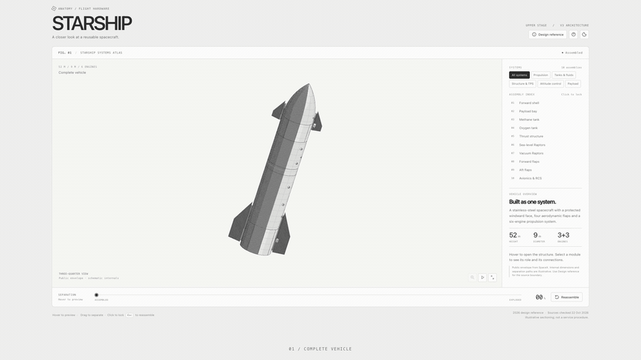
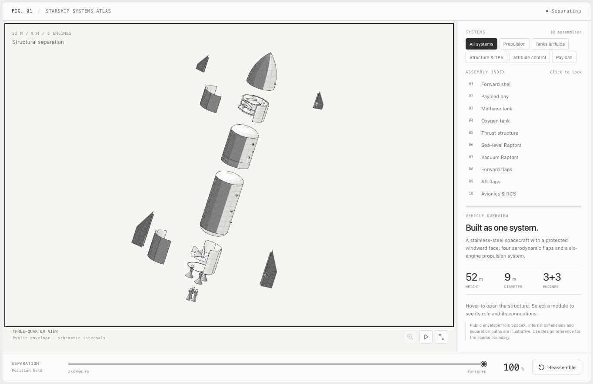
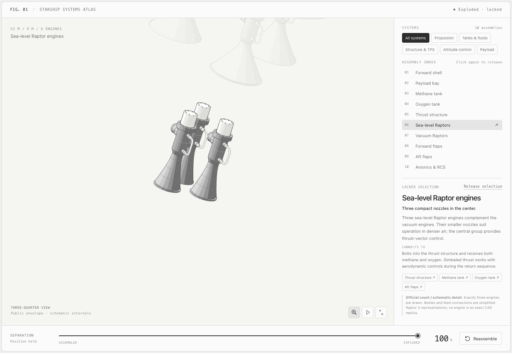
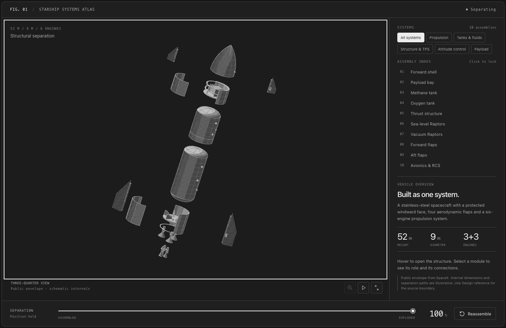
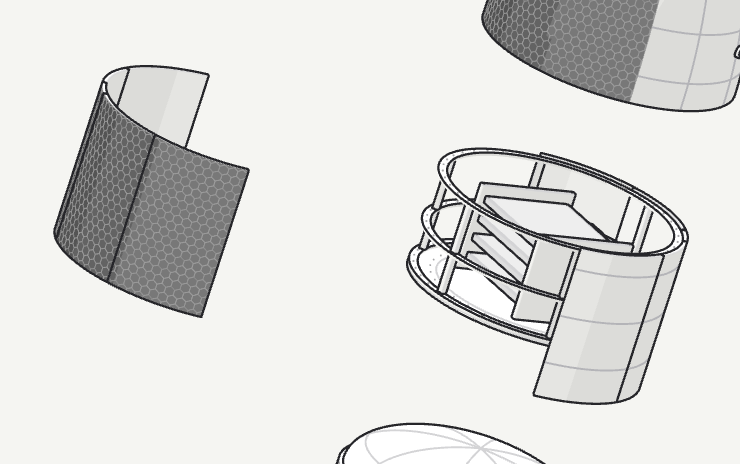

# Starship Anatomy

An interactive SVG explainer of SpaceX Starship’s structure and systems, built with [Anatomy](https://github.com/wheresryan22/anatomy).

Explore ten major assemblies: hover to separate the vehicle, drag to control the spacing, select a module to understand its role, and zoom in to inspect the details. The interface supports mouse, keyboard and touch, with light and dark themes.



**[Watch the 44-second demo](media/starship-demo.mp4)** · **[Download the video](https://raw.githubusercontent.com/LuozhuZhang/starship-anatomy/main/media/starship-demo.mp4)** · **[View the screenshot gallery](docs/GALLERY.md)**

## Try it

Clone or download this repository and open **`outputs/starship.html`** in your browser. Everything is embedded in the file; no installation, server or internet connection is required.

- **Hover** to preview the exploded structure; move away to reassemble.
- **Drag or use the slider** to hold any separation progress.
- **Click a component** to lock selection; use the magnifier for a closer look.
- **Filter by system**: propulsion, tanks and fluids, structure and thermal protection, attitude control, or payload.
- **Keyboard**: ← / → adjusts separation, ↑ / ↓ selects a module, Enter locks it, and Esc reassembles.

## A look inside

| Exploded view | Engine detail |
|---|---|
|  |  |

| Dark theme | Payload structure |
|---|---|
|  |  |

## Build

Requires **Node.js 22+**. No npm dependencies.

```sh
node build.mjs          # generate the standalone HTML files
node build.mjs --audit  # build and check the geometry
```

Source is in [`src/`](src/), the local Anatomy kit in [`vendor/anatomy/`](vendor/anatomy/), and the recording script in [`scripts/record-demo.mjs`](scripts/record-demo.mjs). See [development and verification](docs/DEVELOPMENT.md) for the full checks and video-generation command.

## Design reference

The illustration follows the **2026 public Starship design reference and V3 architecture**, using [SpaceX’s design page](https://www.spacex.com/vehicles/starship/design) checked on 22 October 2026 and the [V3 update dated 12 May 2026](https://www.spacex.com/updates#starship-v3).

Internal dimensions, supports, pipe routes and the payload rack are **schematic**. The separation explains the structure; it is not a maintenance procedure or flight simulation. This is an independent educational project, not an official SpaceX product.

## License

[MIT](LICENSE). The vendored Anatomy kit retains its [upstream MIT license](vendor/anatomy/LICENSE) and [local modification notice](vendor/anatomy/NOTICE.md).
